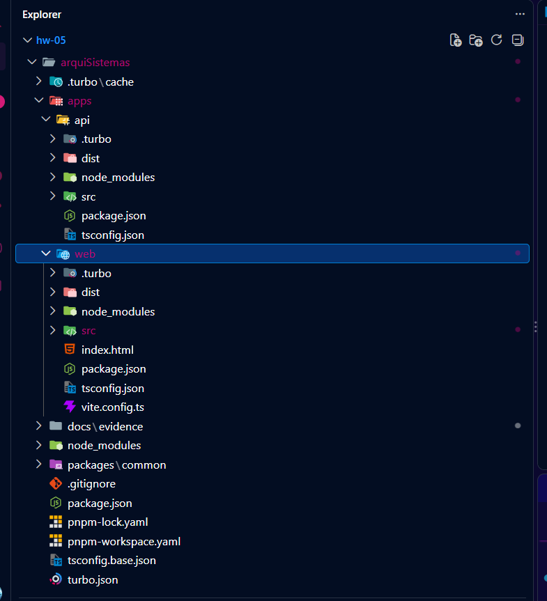
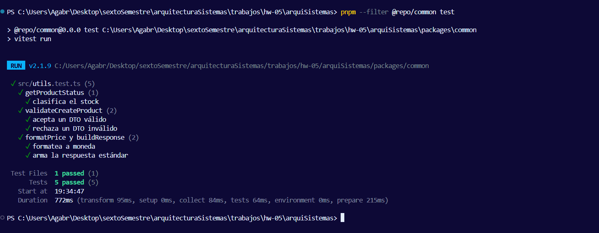
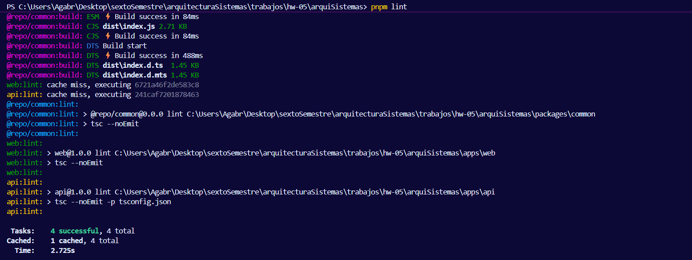
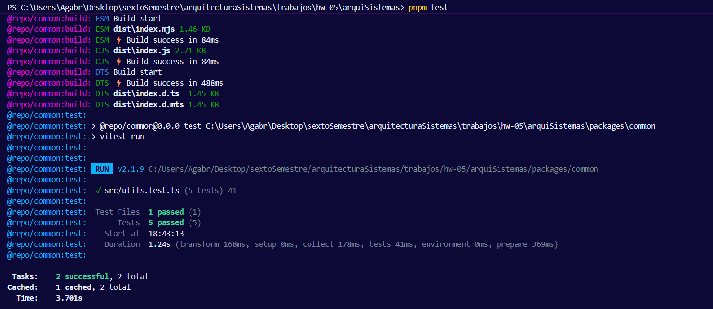
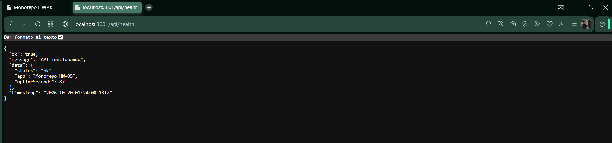
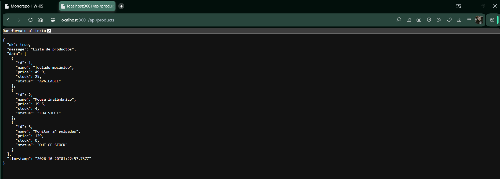
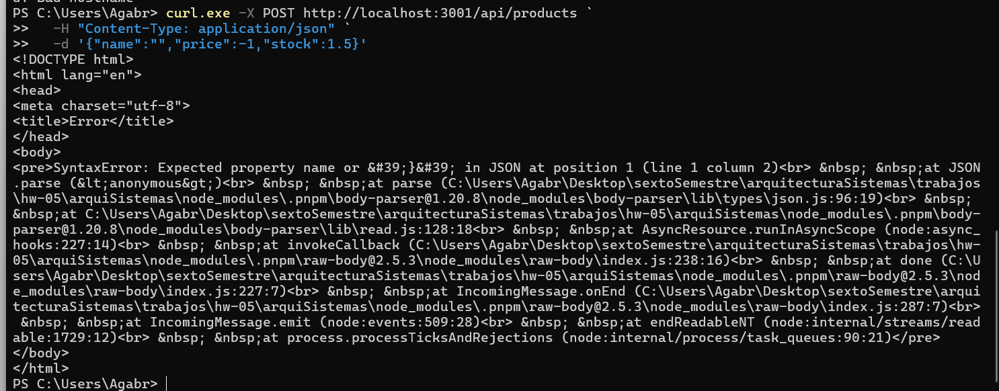
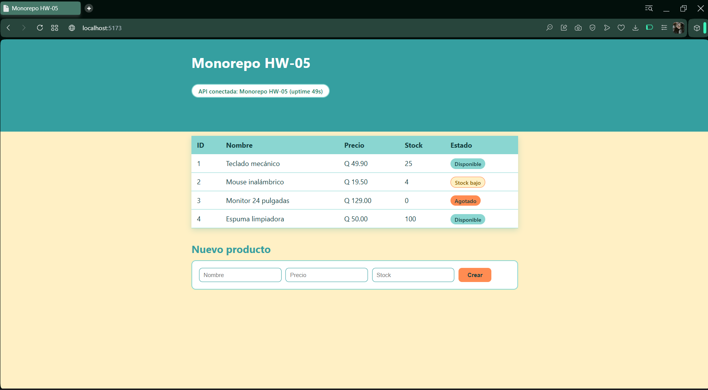
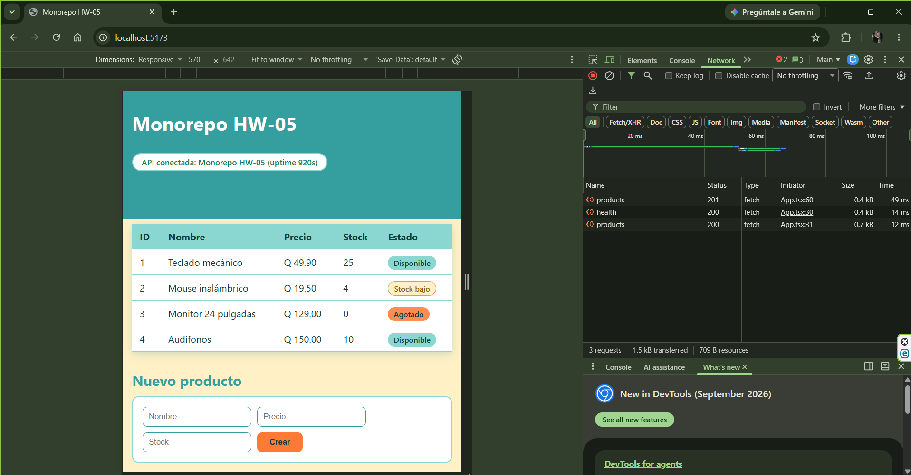
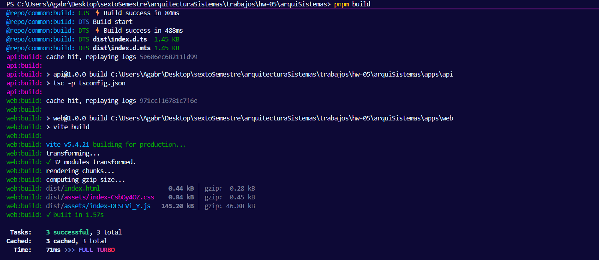

# Monorepo HW-05
Monorepo en TypeScript administrado con **Turborepo** y **pnpm**. Incluye un backend
(Express), un frontend (React + Vite) y una librería compartida (`@repo/common`) que ambas
aplicaciones consumen activamente.
> Asignación: hw-05 | Rama de entrega: `hw-05` | Autor: Angela Chiyal | Curso: Arquitectura de sistemaws

## Contenido
1. Estructura del proyecto
2. Stack tecnológico
3. Justificación técnica
4. Requisitos
5. Puesta en marcha desde cero
6. Comandos disponibles desde la raíz
7. Uso de la librería compartida
8. Endpoints de la API
9. Evidencias
10. Convención de commits

## 1. Estructura del proyecto
```text
monorepo-hw-05/
|-- apps/
| |-- api/ # Backend Express + TypeScript (puerto 3001)
| | |-- src/index.ts
| | |-- package.json
| | `-- tsconfig.json
| `-- web/ # Frontend React + Vite (puerto 5173)
| |-- src/
| | |-- App.css
| | |-- App.tsx
| | `-- main.tsx
| |-- index.html
| |-- package.json
| |-- tsconfig.json
| `-- vite.config.ts
|-- packages/
| `-- common/ # Librería compartida: @repo/common
| |-- src/
| | |-- constants.ts
| | |-- index.ts
| | |-- types.ts
| | |-- utils.test.ts
| | `-- utils.ts
| |-- package.json
| `-- tsconfig.json
|-- docs/evidence/ # Capturas de pantalla
|-- .gitignore
|-- package.json # Scripts y dependencias globales
|-- pnpm-lock.yaml
|-- pnpm-workspace.yaml # Define los workspaces
|-- tsconfig.base.json # Configuración TypeScript compartida
`-- turbo.json # Pipelines de Turborepo
```

| Workspace | Tipo | Paquete | Función |
|---|---|---|---|
| `apps/api` | Aplicación | `api` | API REST con Express |
| `apps/web` | Aplicación | `web` | Cliente React que consume la API |
| `packages/common` | Librería | `@repo/common` | Tipos, DTOs, constantes, utilidades |


## 2. Stack tecnológico
Turborepo 2, pnpm, TypeScript 5, Express 4, React 18, Vite 5, tsup, Vitest y tsx.

## 3. Justificación técnica
### Turborepo frente a Nx y Lerna
| Criterio | Turborepo | Nx | Lerna |
|---|---|---|---|
| Curva de aprendizaje | Baja (un `turbo.json`) | Media/alta | Media |
| Caché de tareas | Sí (local y remota) | Sí (local y remota) | Delegada a Nx |
| Configuración | Mínima | Amplia (plugins) | Mínima |
| Foco principal | Orquestar tareas | Plataforma completa | Versionado/publicación |
| Encaje aquí | Alto | Sobredimensionado | Innecesario (privados) |
Se eligió **Turborepo** porque resuelve justo lo que el proyecto necesita (ejecutar tareas
en el orden correcto del grafo y cachearlas) con una configuración mínima y sobre los
workspaces nativos del gestor de paquetes. Nx aporta generadores y análisis avanzado que
aquí no se aprovechan; Lerna se centra en versionar y publicar paquetes, y los paquetes
de este repositorio son privados.

### pnpm frente a npm workspaces
pnpm enlaza paquetes locales con `workspace:*`, impide importar dependencias no declaradas (sin "dependencias fantasma"), instala más  rápido y ahorra disco con su almacén global.

## 4. Requisitos
- Node.js 20 o superior
- pnpm (se activa con `corepack enable`)
- Git


## 5. Puesta en marcha desde cero
```bash

git clone https://github.com/Angebriela/arquiSistemas.git
cd arquiSistemas
git checkout hw-05
corepack enable
pnpm install
pnpm build
pnpm dev
```

1. Abre http://localhost:5173 para ver el frontend.
2. Abre http://localhost:3001/api/health para verificar el backend.

## 6. Comandos disponibles desde la raíz
| Comando | Descripción |
|---|---|
| `pnpm install` | Instala dependencias de todos los workspaces |
| `pnpm dev` | `turbo run dev`: api y web en paralelo |
| `pnpm build` | `turbo run build`: compila todo en orden |
| `pnpm lint` | Chequeo de tipos en todos los workspaces |
| `pnpm test` | Pruebas (Vitest) |
| `pnpm dev:api` | Solo el backend (`--filter=api`) |
| `pnpm dev:web` | Solo el frontend (`--filter=web`) |
| `pnpm build:api` | Compila api y sus dependencias |
| `pnpm build:web` | Compila web y sus dependencias |
| `pnpm build:common` | Compila la librería compartida |
| `pnpm start:api` | Ejecuta el backend compilado |

## 7. Uso de la librería compartida
- **api** importa `API_ROUTES`, `buildResponse`, `getProductStatus` y
`validateCreateProduct` desde `@repo/common`.
- **web** importa `API_ROUTES`, `APP_NAME`, `formatPrice`, `validateCreateProduct` y los tipos `ApiResponse`, `ProductWithStatus` y `CreateProductDto`.

## 8. Endpoints de la API
| Método | Ruta | Descripción |
|---|---|---|
| GET | `/api/health` | Estado del servicio |
| GET | `/api/products` | Lista de productos con su estado |
| POST | `/api/products` | Crea un producto (validado con `@repo/common`) |

## 9. Evidencias

### Estructura del monorepo

}
### Compilación orquestada con Turbo


### Pruebas y lint



### Backend en ejecución




### Frontend en ejecución



### Ejecución filtrada y caché

